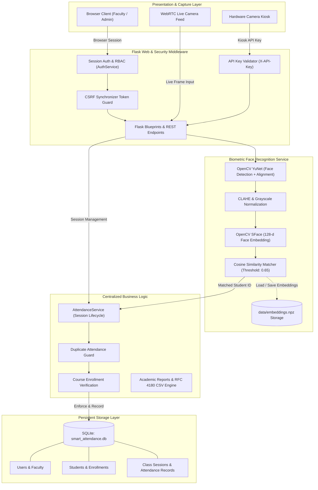

# Smart Attendance System using Face-Recognition Scanner

[](https://www.python.org/)
[](https://flask.palletsprojects.com/)
[](https://github.com/opencv/opencv_zoo)
[](https://opencv.org/)
[](https://www.sqlite.org/)
[](file:///c:/Users/bhoom/Desktop/SoftwareEng_LabProject/tests)
[]()

> **Academic Project:** Software Engineering Laboratory (`CSE3132`)  
> **Institution:** Department of Computer Science & Engineering, Manipal University Jaipur  
> **Architecture:** Flask Web Application + SQLite Persistent Store + OpenCV YuNet face detection + SFace face embeddings

---

## Table of Contents

- [1. Overview](#1-overview)
- [2. System Architecture](#2-system-architecture)
- [3. Key Features](#3-key-features)
  - [Real-Time Biometric Face Recognition](#real-time-biometric-face-recognition)
  - [Authoritative Attendance Business Logic](#authoritative-attendance-business-logic)
  - [Security, Authentication & RBAC](#security-authentication--rbac)
  - [Course & Academic Roster Management](#course--academic-roster-management)
  - [Academic Reporting & CSV Export](#academic-reporting--csv-export)
- [4. Repository Structure](#4-repository-structure)
- [5. Database Schema & Data Model](#5-database-schema--data-model)
- [6. Prerequisites & Installation](#6-prerequisites--installation)
- [7. Configuration & Environment Variables](#7-configuration--environment-variables)
- [8. Running the Application](#8-running-the-application)
- [9. Default Seeded Accounts & Courses](#9-default-seeded-accounts--courses)
- [10. Biometric Enrollment & Camera Verification](#10-biometric-enrollment--camera-verification)
- [11. API Reference](#11-api-reference)
- [12. Automated Test Suite](#12-automated-test-suite)
- [13. Physical-Camera vs. Synthetic Test Protocol](#13-physical-camera-vs-synthetic-test-protocol)
- [14. Contributors & Academic Attribution](#14-contributors--academic-attribution)

---

## 1. Overview

The **Smart Attendance System** is an automated, secure, and privacy-first biometric attendance management platform designed to replace proxy-prone roll calls and manual paper sheets.

The system integrates real-time optical face recognition with a relational database backend and strict role-based access controls. Camera frames captured via browser WebRTC or external hardware kiosks are analyzed with OpenCV **YuNet** for face localization and landmark alignment, and identity embeddings are extracted with **SFace**, a network trained for face verification (**128-dimensional normalized embeddings**). Biometric verification is evaluated via cosine similarity matching against enrolled student templates.

Attendance state transitions, duplicate prevention, session lifecycles, and academic eligibility criteria are enforced by a single authoritative service layer backed by SQLite.

---

## 2. System Architecture

The following diagram illustrates the interaction between presentation, security middleware, facial recognition pipelines, business services, and database persistence:



---

## 3. Key Features

### Real-Time Biometric Face Recognition
- **Face Detection**: OpenCV YuNet with 5-point landmarks for alignment (Haar Cascade is kept only as a fallback).
- **Face Embedding**: OpenCV SFace (ONNX) produces unit-normalized 128-d embeddings. Matching is restricted to the session roster (course + section), uses a cosine threshold of 0.50 and rejects ambiguous near-ties.
- **Biometric Matching**: Computes cosine similarity between query probe embeddings and stored student templates against a configurable cutoff (`RECOGNITION_THRESHOLD=0.65`).
- **Privacy-by-Design**: **Raw photographs or facial images are never permanently saved to disk or committed to Git.** Only compressed, anonymized mathematical arrays are persisted in `data/embeddings.npz`.
- **Edge-Case Handling**: Deterministically handles and rejects missing cameras, zero faces detected, multiple faces in a single frame, and unrecognized probe faces.

### Authoritative Attendance Business Logic
- **Single Source of Truth**: All attendance decisions flow through [`AttendanceService`](file:///c:/Users/bhoom/Desktop/SoftwareEng_LabProject/attendance_service.py). No in-memory stores, temporary mocks, or silent fallbacks exist.
- **Session Lifecycle**: Attendance can only be recorded during an `Active` session. Once closed (`Completed`), subsequent attempts are rejected (`HTTP 400`).
- **Duplicate Prevention**: Immediate rejection if a student attempts to scan again in the same class session (`status: 'already_marked'`).
- **Enrollment Verification**: A student must be registered in SQLite and actively enrolled in the course roster; otherwise, recognition is rejected (`status: 'not_enrolled'`).
- **Faculty Ownership Enforcement**: Faculty members can only initiate sessions and mark attendance for courses they are assigned to instruct.
- **Manual Corrections**: Authorized faculty can manually mark students present or update statuses with an audit trail.

### Security, Authentication & RBAC
- **Password Security**: Passwords hashed using PBKDF2-HMAC-SHA256 with 260,000 rounds via `werkzeug.security`.
- **Role-Based Access Control**:
  - `admin`: Full administrative access to courses, faculty, students, and global reports.
  - `faculty`: Session initialization, camera scanner controls, course management, and roster editing.
  - `student`: Read-only view of enrolled courses and personal attendance percentages.
- **Session Fixation Defense**: Flask sessions are invalidated and regenerated upon login and logout.
- **CSRF Protection**: Synchronizer Token Pattern enforced on all state-changing browser requests (`POST`, `PUT`, `DELETE`).
- **Machine-to-Machine API Key**: Automated camera kiosks authenticate via `X-API-Key` or `Authorization: Bearer <KEY>` header, exempt from browser CSRF tokens.
- **Production Safeguards**: In production mode (`FLASK_ENV=production`), application startup aborts if default or insecure secret keys are detected.

### Course & Academic Roster Management
- **Course Administration**: Create courses with custom credits, semester number, academic year, and verified faculty assignment.
- **Roster Mapping**: Bulk and individual enrollment of students into courses backed by composite primary keys (`course_id`, `student_id`).

### Academic Reporting & CSV Export
- **Live Statistics**: Real-time dashboard calculating total students, registered biometric profiles, active sessions, and overall attendance rate.
- **Attendance Percentage**: Calculated per student per course, with automated low-attendance warnings for students falling below the mandatory **75%** threshold.
- **RFC 4180 CSV Export**: Generates compliant CSV exports for individual courses or all courses (`course_id=all`) with proper quoting and escaping for names with commas or quotes.

---

## 4. Repository Structure

```text
SoftwareEng_LabProject/
├── .env.example                  # Environment configuration template
├── .gitignore                    # Git exclusion rules (caches, DBs, temporary artifacts)
├── BACKEND_CONTRACT.md           # API and service contract specification
├── README.md                     # Comprehensive project documentation (this file)
├── requirements.txt              # Production and test Python dependencies
├── smart_attendance.db           # SQLite database file (development)
│
├── attendance_service.py         # Authoritative attendance business logic & CSV engine
├── auth.py                       # Authentication, password hashing, session security & RBAC
├── config.py                     # Centralized environment configuration and security guards
├── database.py                   # SQLite schema initialization, connection helper, and seed data
├── data_provider.py              # Database-backed UI data provider and catalog interface
├── seed_demo.py                  # Builds the demo DB from seed/sample_data.json (enrols faces from photos)
├── fetch_models.py               # Downloads the YuNet + SFace ONNX models into models_cv/
├── seed/sample_data.json         # Teachers, courses, section assignments and students for the demo
├── face_recognition_service.py   # YuNet detection, SFace embeddings & cosine matcher
├── frontend_bp.py                # Server-rendered web routes, forms, and session controllers
├── models.py                     # SQLite entity models (Users, Faculty, Students, Sessions, etc.)
├── run_frontend_dev.py           # Main Flask application entrypoint & REST API endpoints
├── verify_webcam.py              # Optical camera verification and live detection script
│
├── data/
│   └── embeddings.npz            # Compressed float32 biometric feature vectors (local storage)
│
├── docs/
│   └── FACE_RECOGNITION_INTERFACE.md # Biometric service technical specification
│
├── static/                       # CSS stylesheets, JavaScript modules, and vendor assets
│   ├── css/                      # Custom tech-inspired styles and components
│   └── js/                       # Client-side scripts (session scanning, reports, enrollment)
│
├── templates/                    # Jinja2 HTML templates
│   ├── base.html                 # Main layout template with navigation and notifications
│   ├── courses.html              # Course catalog, creation modal, and roster manager
│   ├── dashboard.html            # Faculty / Admin analytics overview
│   ├── login.html                # Secure authentication portal
│   ├── reports.html              # Academic attendance reports & CSV download controls
│   ├── session.html              # Live camera scanning & optical attendance interface
│   └── students.html             # Student roster directory & biometric registration modal
│
└── tests/                        # Automated unit, integration, and security test suites
    ├── test_backend.py           # Database, model, and attendance service tests
    ├── test_e2e_integration.py   # End-to-end integration, restart persistence & CSV tests
    ├── test_face_recognition.py  # Face detector, feature extractor & cosine matcher tests
    ├── test_frontend.py          # UI endpoints, session views, and form action tests
    ├── test_live_attendance_api.py # Real-time camera recognition endpoint tests
    └── test_security.py          # Auth, RBAC, CSRF, API key kiosk, and session security tests
```

---

## 5. Database Schema & Data Model

The SQLite database (`smart_attendance.db`) is structured with relational integrity and strict foreign keys:

| Table | Primary Key | Key Columns | Purpose |
| :--- | :--- | :--- | :--- |
| `users` | `id` (INTEGER AUTO) | `username`, `password_hash`, `role` | User accounts and RBAC credentials |
| `faculty` | `faculty_id` (TEXT) | `user_id`, `name`, `email`, `department` | Instructor profiles linked to `users(id)` |
| `students` | `student_id` (TEXT) | `roll_number`, `name`, `email`, `program`, `semester`, `face_registered` | Enrolled student registry and face status |
| `courses` | `course_id` (TEXT) | `course_code`, `course_name`, `credits`, `faculty_id`, `semester`, `academic_year` | Academic courses mapped to `faculty(faculty_id)` |
| `enrollments` | `(course_id, student_id)` | `enrollment_date` | Course roster mapping with composite PK |
| `class_sessions`| `session_id` (TEXT) | `course_id`, `faculty_id`, `date`, `start_time`, `end_time`, `status`, `room`, `topic` | Lecture sessions (`Active` or `Completed`) |
| `attendance_records` | `attendance_id` (INTEGER AUTO) | `session_id`, `student_id`, `course_id`, `timestamp`, `status`, `verification_method`, `confidence_score` | Attendance logs with composite uniqueness `(session_id, student_id)` |

---

## 6. Prerequisites & Installation

### Prerequisites
- **Python**: 3.10 or 3.11
- **C/C++ Build Tools**: Required on some platforms for compiling OpenCV / PyTorch binaries.
- **Webcam**: Integrated or external USB webcam (optional for automated tests; required for live optical camera testing).

### Installation Steps

1. **Clone the repository**:
   ```powershell
   git clone https://github.com/BhoomiSaraf/SoftwareEng_LabProject.git
   cd SoftwareEng_LabProject
   ```

2. **Create and activate a virtual environment**:
   ```powershell
   # Windows PowerShell
   python -m venv venv
   .\venv\Scripts\Activate.ps1
   ```
   *(On macOS / Linux: `source venv/bin/activate`)*

3. **Install dependencies**:
   ```powershell
   pip install --upgrade pip
   pip install -r requirements.txt
   ```

4. **Initialize environment configuration**:
   ```powershell
   Copy-Item .env.example -Destination .env
   ```

---

## 7. Configuration & Environment Variables

Configure application settings by modifying `.env` in the project root:

| Variable | Default Value | Description |
| :--- | :--- | :--- |
| `FLASK_ENV` | `development` | Environment mode (`development`, `testing`, `production`). |
| `SECRET_KEY` | *(dev key)* | Session encryption key. **Must be randomly generated in production.** |
| `SESSION_COOKIE_SECURE` | `false` | Set to `true` when serving over HTTPS/TLS. |
| `PERMANENT_SESSION_LIFETIME`| `3600` | Browser session timeout in seconds (1 hour). |
| `DB_PATH` | `smart_attendance.db` | Path to the SQLite database file. |
| `CAMERA_API_KEY` | *(empty)* | Shared secret key for hardware camera kiosks to bypass CSRF. |
| `EMBEDDINGS_FILE` | `data/embeddings.npz` | Path to the compressed numeric biometric embeddings file. |
| `RECOGNITION_THRESHOLD` | `0.65` | Cosine similarity threshold for face verification ($0.0 \text{--} 1.0$). |
| `DEFAULT_COURSE_CREDITS` | `3` | Default credits assigned when not specified. |
| `DEFAULT_COURSE_SEMESTER`| `5` | Default semester number assigned when not specified. |
| `DEFAULT_ACADEMIC_YEAR` | `2026-2027` | Default academic year assigned when not specified. |
| `FLASK_DEBUG` | `false` | Flask debug reloader flag. |

---

## 8. Running the Application

1. **One-time setup** (downloads the face models, then builds the demo database):
   ```powershell
   pip install -r requirements.txt
   python fetch_models.py
   python seed_demo.py            # backs up any existing DB/embeddings to backups/, then rebuilds
   ```
2. **Start the server**:
   ```powershell
   python run_frontend_dev.py
   ```
3. Open [http://127.0.0.1:5000](http://127.0.0.1:5000) and sign in.

`python seed_demo.py --keep` adds missing rows without deleting anything; `--with-history` also creates past sessions
for the *sample* students (marked `Simulated Scanner`) so the reports have data.

---

## 9. Roles, Seeded Accounts & Data

| Role | Can do |
| :--- | :--- |
| **Administrator** | Register students (with section), create courses, assign a teacher to each course section, edit rosters, capture face references, view every report |
| **Faculty** | See only the courses/sections they teach, start attendance sessions for those sections, mark manually, view reports and CSV for their own sections |

Students are divided **by section (A/B/C)**. A course is offered to one or more sections and each
section has its own teacher (`course_sections` table). A session belongs to one course section; its roster is the
students enrolled in the course who sit in that section, and face matching only considers that roster.

### Logins (all data comes from `seed/sample_data.json`)
| Role | Username | Password |
| :--- | :--- | :--- |
| Administrator | `admin` | `admin123` |
| Faculty (8) | `rajesh.kumar`, `meenakshi.s`, `sanjay.verma`, `neha.gupta`, `arvind.mathur`, `pooja.agarwal`, `vikram.rathore`, `kavita.joshi` | `faculty123` |

The seed contains 10 courses, 27 course-section assignments and 28 students. **Bhoomi Saraf (`STU001`) is the real record**: her
face is enrolled from `data/faces/bhoomi_saraf.jpg` (git-ignored). Everyone else is sample data without a face until an
administrator captures one. To add real people, add them to the JSON with a `photo` path and re-run `seed_demo.py`.

---

## 10. Biometric Enrollment & Camera Verification

### Web UI (administrators)
1. Sign in as `admin`, open **Students**.
2. Click **Capture Face** on a student, start the webcam (or upload a photo) and capture. Exactly one face must be in frame.
3. The embedding is stored in `data/embeddings.npz` under the student's `student_id`; the Students table then shows *Enrolled*.

### Camera check
```powershell
python verify_webcam.py
```
Press `q` to exit the live camera preview window.

---

## 11. API Reference

All requests that modify state require either a valid CSRF token in browser sessions or a valid API key for hardware kiosks.

| Method | Endpoint | Access / Auth | CSRF / API Key | Description |
| :--- | :--- | :--- | :--- | :--- |
| `GET` | `/login` | Public | None | Displays login page and sets CSRF cookie |
| `POST` | `/login` | Public | Form `csrf_token` | Authenticates user and regenerates session |
| `GET` | `/logout` | Authenticated | None | Invalidates session and redirects to login |
| `POST` | `/actions/sessions/start` | Faculty / Admin | Form `csrf_token` | Starts an active class session for a course |
| `POST` | `/actions/courses/create` | Faculty / Admin | Form `csrf_token` | Creates course with credits, semester & faculty |
| `POST` | `/api/sessions/<id>/recognize` | Faculty / Admin / Kiosk | `X-CSRFToken` OR `X-API-Key` | Submits camera frame for biometric matching and attendance marking |
| `POST` | `/api/sessions/<id>/end` | Faculty / Admin | `X-CSRFToken` | Concludes active session and prevents further marking |
| `POST` | `/api/students/<id>/register-face` | Admin | `X-CSRFToken` | Computes & persists the face embedding for a student |
| `POST` | `/api/courses/<id>/enroll` | Faculty / Admin | `X-CSRFToken` | Enrolls student IDs into the course roster |
| `GET` | `/api/courses/<id>/enrollment-data` | Authenticated | None | Retrieves course enrollment roster and status |
| `GET` | `/api/reports/data` | Faculty / Admin | None | Returns JSON attendance analytics for a course |
| `GET` | `/api/reports/export-csv` | Faculty / Admin | None | Downloads RFC 4180 CSV export (`?course_id=all` or specific) |

---

## 12. Automated Test Suite

The test suite covers backend logic, security controls, live API contracts, face recognition models, and end-to-end multi-faculty flows.

### Running All Tests
```powershell
python -m pytest -v
```

### Test Suite Structure (91 Passing Tests)

```text
test_backend.py .................................................... 8 passed
  - test_database_initialization_and_seeding
  - test_auth_service
  - test_models_student_and_enrollment
  - test_session_lifecycle
  - test_attendance_marking_and_duplicate_prevention
  - test_attendance_reports_and_percentages
  - test_manual_override
  - test_csv_export

tests/test_live_attendance_api.py .................................. 8 passed
  - test_valid_recognised_enrolled_student_marked_once
  - test_repeated_request_does_not_create_second_attendance_record
  - test_unrecognised_face_cannot_create_attendance
  - test_student_not_enrolled_cannot_be_marked
  - test_inactive_or_closed_session_rejects_attendance
  - test_ending_session_changes_persisted_state
  - test_database_write_failure_not_reported_as_success
  - test_missing_image_payload_returns_400

tests/test_security.py ............................................ 21 passed
  - test_password_hashing_and_verification
  - test_role_enforcement_and_hierarchy
  - test_session_fixation_protection
  - test_csrf_cookie_present_on_login_page
  - test_csrf_protection_rejects_browser_session_without_token
  - test_csrf_valid_token_accepted_on_session_state_change
  - test_camera_api_key_valid_allows_m2m_without_csrf
  - test_camera_api_key_invalid_returns_401
  - test_camera_api_key_supported_headers (X-API-Key, Bearer)
  - test_faculty_cannot_modify_another_instructors_session
  - (and 11 additional security boundary tests)

tests/test_frontend.py ............................................ 21 passed
  - test_unauthenticated_redirect
  - test_login_page_has_no_prefilled_credentials
  - test_login_with_seeded_faculty
  - test_mvp_badge_removed_from_every_page
  - test_admin_sees_admin_controls
  - test_faculty_has_no_admin_controls
  - test_faculty_only_sees_own_courses_and_students
  - test_admin_creates_course_with_sections_and_enrols_them
  - test_faculty_cannot_create_course_or_student
  - test_admin_roster_and_face_apis_are_admin_only
  - test_session_roster_is_the_chosen_section_only
  - test_manual_mark_rejects_other_section_and_duplicates
  - test_report_percentages_are_per_section
  - (and 8 additional presentation and role tests)

tests/test_sections_and_roles.py ................................... 4 passed
  - test_section_schema_migration_and_defaults
  - test_attendance_rejected_when_student_in_wrong_section
  - test_non_admin_cannot_create_course
  - test_non_admin_cannot_register_student

tests/test_face_recognition.py .................................... 15 passed
  - test_cascade_initialization
  - test_mobilenet_feature_extractor_dimension (576-d)
  - test_cosine_similarity_calculation
  - test_no_face_detection_handling
  - test_multiple_face_detection_handling
  - test_embeddings_npz_persistence_and_reload
  - (and 9 additional vision pipeline unit tests)

tests/test_face_sface.py ........................................... 6 passed
  - test_sface_feature_dimension
  - test_sface_cosine_similarity
  - test_sface_embedding_normalization
  - (and 3 additional SFace pipeline unit tests)

tests/test_e2e_integration.py ...................................... 8 passed
  - test_1_student_creation_and_persistence
  - test_2_faculty_assignment_and_course_attributes
  - test_3_enrollment_lifecycle_and_duplicate_rejection
  - test_4_face_encoding_persistence_and_failure_honesty
  - test_5_biometric_scenarios_deterministic_and_synthetic
  - test_6_true_restart_persistence
  - test_7_csv_export_multi_course_and_edge_cases
  - test_8_invalid_identifiers_produce_honest_errors
```

---

## 13. Physical-Camera vs. Synthetic Test Protocol

> [!NOTE]
> **Why Synthetic Tests Are Used in Automated CI**:
> Automated tests in `test_e2e_integration.py` and `test_live_attendance_api.py` run in headless environments where physical cameras and ambient lighting cannot be controlled. They use synthetic image arrays and controlled detector coordinates to deterministically verify all state branches (`no_face`, `multiple_faces`, `unrecognized`, `marked`, `already_marked`, `not_enrolled`, `session_inactive`).

### Protocol for Physical Optical Verification in the Lab
When evaluating the project in person with real camera hardware:
1. Ensure camera lens is clean and ambient lighting is between $300\text{--}500\text{ lux}$ without heavy backlighting.
2. Launch the application: `python run_frontend_dev.py`.
3. Sign in as faculty and start an active attendance session for `CSE3132`.
4. Point the camera at the enrolled student's face. Verify:
   - Green bounding box tracks the face.
   - Successful recognition banner indicates: `Student Bhoomi Saraf (229301045) recognized — Attendance Marked Present`.
5. Present the same face a second time. Verify:
   - Yellow alert indicates: `Duplicate attendance blocked: Bhoomi Saraf is already marked Present`.
6. Present an unregistered person's face. Verify:
   - Red banner indicates: `Unrecognized face. Biometric confidence below threshold`.

---

## 14. Contributors & Academic Attribution

This project was developed for the **Software Engineering Laboratory (CSE3132)** at **Manipal University Jaipur**:

- **Bhoomi Saraf** — Lead Architecture, Backend & Database Consolidation, Biometric Face Pipeline (`Registration No: 229301045`)
- **Kanakpreet Kaur** — (`Registration No: 229301088`)
- **Apoorva Kala** — (`Registration No: 229301112`)

*Developed under the guidance of the Department of Computer Science & Engineering, Manipal University Jaipur.*

